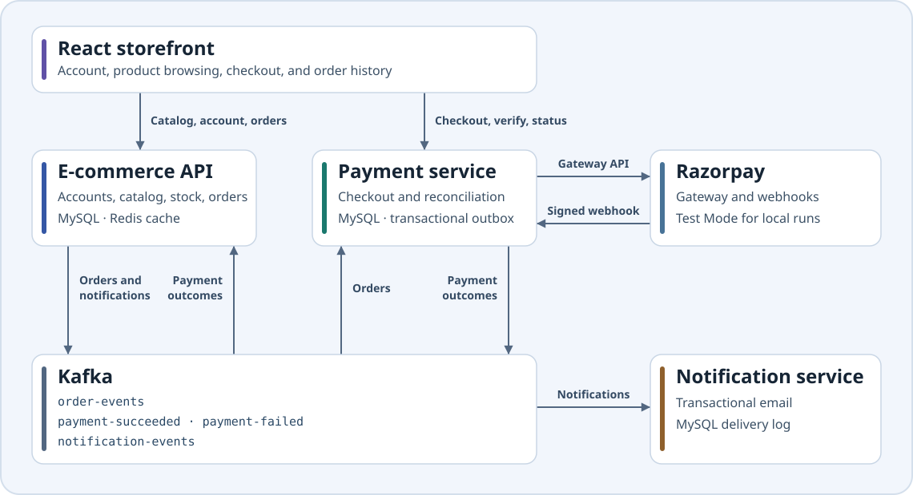

<h1 align="center">E-commerce Backend</h1>

  <strong>An event-driven Spring Boot API for the storefront</strong>

  
  
  
  
  

---

## Introduction

The E-commerce Backend owns customer accounts, saved addresses, the product catalog, inventory, and orders. Shoppers can sign in, recover their accounts, browse products, and track orders. Administrators manage products, stock, and order status through role-protected APIs.

When a shopper checks out, the backend prices the order from the catalog and deducts stock. It saves the pending order and its outgoing event in the same MySQL transaction using a transactional outbox. Payment outcomes arrive through Kafka and drive order confirmation or cancellation. A Spring event listener publishes the corresponding notification after the order transaction commits.

> **Checkout recovery verified in Razorpay Test Mode.** With the browser's payment verification request blocked, Razorpay delivered a capture webhook and the order reached `CONFIRMED`.

## System Overview

The React storefront uses the e-commerce API for accounts, product browsing, and orders. It calls the payment service to start Razorpay checkout and check payment status. Razorpay sends signed webhooks to the payment service. Kafka carries order and payment events between the backends, and the notification service consumes Kafka events to send email.

| Component | Responsibility |
|---|---|
| **E-commerce Backend** | This repository. Owns customer accounts, saved addresses, the catalog, inventory, and orders. |
| [Payment Service](https://github.com/Aashirshaikh07/payment-service) | Creates Razorpay checkout orders, reconciles captures from callbacks and webhooks, and publishes payment outcomes. |
| [Notification Service](https://github.com/Aashirshaikh07/notification-service) | Consumes notification events and delivers welcome, password reset, and order emails. |
| [React Storefront](https://github.com/Aashirshaikh07/e-commerce-frontend) | Provides product browsing, account screens, checkout, and order history. The repository is private. |

## Order Lifecycle

### Place the order

The storefront calls `POST /api/v1/orders` with product IDs, quantities, and an `Idempotency-Key`. The backend looks up the products, checks available stock, and calculates the total using catalog prices. It commits the `PENDING` order, line items, stock deduction, idempotency record, and order-created outbox entry in one MySQL transaction. [Order creation transaction](src/main/java/com/aashir/ecommerce/service/OrderCreationTransactionService.java)

### Retry order creation

If MySQL commits the order and the browser loses the response, the storefront can retry the same request with its original key. The backend looks up the key for the signed-in customer and compares a SHA-256 fingerprint of the product IDs and quantities, sorted by product ID.

| Request | Result |
|---|---|
| First valid request with a new key | `201 Created` with a new order. |
| Same customer, key, and fingerprint | `200 OK` with the existing order. The requests result in one stock deduction and one order-created outbox entry. |
| Same customer and key, different fingerprint | `409 Conflict`. The key is already associated with a different request. |

MySQL enforces uniqueness on `(user_id, idempotency_key)`. The transaction claims the key before touching stock. If two matching requests arrive together and one hits the unique constraint, the service can recover the order created by the other request. A fresh key represents a new order request. [Retry handling](src/main/java/com/aashir/ecommerce/service/OrderService.java#L61) · [Request fingerprint](src/main/java/com/aashir/ecommerce/service/OrderRequestFingerprint.java) · [Unique key](src/main/java/com/aashir/ecommerce/entity/OrderIdempotency.java)

### Open checkout and verify payment

The order outbox publishes to `order-events`, which the payment service consumes to prepare a payment. The storefront calls `POST /payments/{orderId}/checkout` with a separate key, `checkout-{orderId}`. A replay of a completed checkout returns the existing Razorpay order.

After the Razorpay callback, the storefront calls `POST /payments/verify`. For a new verification, the payment service checks that the payment belongs to the customer, validates the callback signature, and fetches the payment from Razorpay. It checks the order and payment IDs, amount, currency, and capture status before recording success. A signed `payment.captured` webhook can also lead to reconciliation if the tab closes or verification fails. [Payment verification](https://github.com/Aashirshaikh07/payment-service/blob/main/src/main/java/com/aashir/payment/service/PaymentVerificationService.java#L33) · [Webhook reconciliation](https://github.com/Aashirshaikh07/payment-service/blob/main/src/main/java/com/aashir/payment/service/WebhookPaymentReconciliationService.java#L29)

### Apply the payment outcome

The payment service writes the capture and a success outbox entry together. When `payment-succeeded` reaches the order backend, the consumer locks the order row and checks `processed_events`. For a new success on a pending order, it moves the order to `CONFIRMED` and records the event ID in the same transaction. The Spring notification listener hands off the confirmation email event after commit. A replay of the same Kafka event skips the update and notification.

The normal order progression is `PENDING → CONFIRMED → SHIPPED → DELIVERED`. A `payment-failed` event can cancel a pending order. The cancellation transaction restores stock. If a capture arrives after cancellation, the order stays `CANCELLED` and the consumer saves one `late_payment_reviews` entry per order and payment. [Payment consumer](src/main/java/com/aashir/ecommerce/kafka/PaymentKafkaConsumer.java) · [Order state rules](src/main/java/com/aashir/ecommerce/entity/OrderStatus.java)
